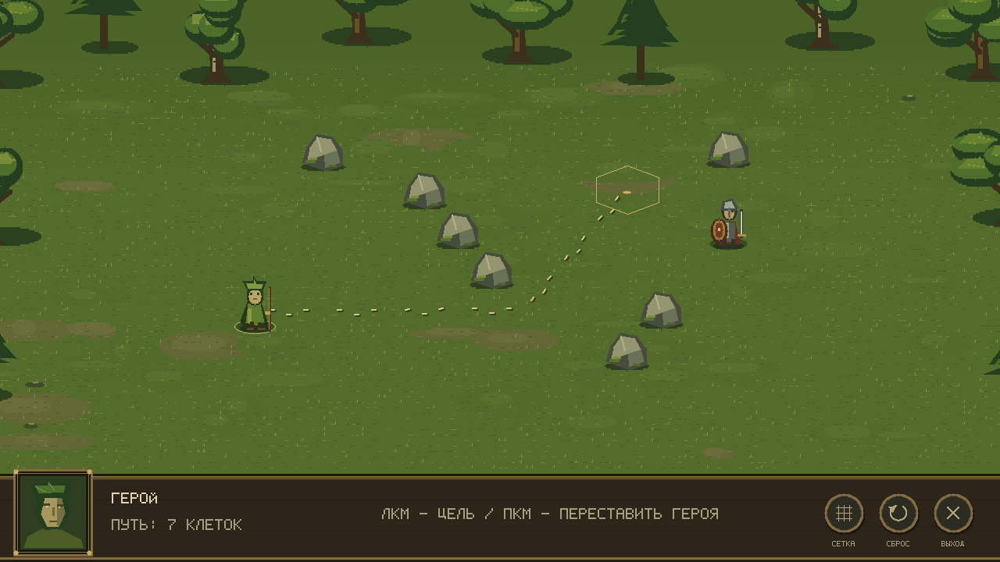

# Три корня

Курсовой проект: пошаговая RPG на C# и MonoGame, без игрового движка. Игрок исследует отдельные карты-кампании, принимает решения в заданиях и сражается на гексагональном поле.

## Требования

- .NET 10 SDK
- Windows, Linux или macOS для запуска MonoGame DesktopGL

## Сборка и запуск

Из папки репозитория:

```powershell
dotnet restore ThreeRoots.sln
dotnet build ThreeRoots.sln
dotnet run --project src/Game.MonoGame/Game.MonoGame.csproj
dotnet test ThreeRoots.sln
```

## Структура

- `src/Game.Core` — правила и модели игры; проект не зависит от графической библиотеки.
- `src/Game.MonoGame` — окно, ввод и отрисовка.
- `tests/Game.Tests` — автоматические проверки правил.
- `content` — кампании, карты и изображения.
- `docs/superpowers` — согласованный дизайн и план реализации курсовой.

## Git для этого проекта

`git status` показывает, какие файлы изменились; `git add <файл>` выбирает изменения для коммита; `git commit -m "описание"` сохраняет их в локальной истории; `git push` отправляет коммиты на GitHub. Перед каждым коммитом запускай `dotnet test ThreeRoots.sln` и проверяй `git status`.

## Модель карты

- `HexCoord` хранит axial-координаты гекса, находит шесть соседей и считает расстояние.
- `WorldTile` описывает клетку: координаты, высоту (от нуля) и проходимость. Свойства задаются при создании и затем не меняются.
- `WorldMap` хранит клетки в словаре по координатам. `Contains` проверяет наличие клетки, `GetTile` возвращает клетку или `null`, `Tiles` позволяет перечислить клетки.

Форму карты задаёт набор существующих клеток: допустимы отрицательные координаты и пустые участки. Непроходимая клетка остаётся частью карты. Повторяющиеся координаты отклоняются; изменения исходного списка клеток не меняют созданную карту.

## Поиск пути и экран-прототип

`BattleMap` хранит рельеф боевого поля. `AStarPathfinder` находит кратчайший путь по существующим проходимым гексам; занятые клетки передаются отдельно. Маршрут включает старт и цель, а его стоимость равна количеству шагов. Если пути нет, `IsReachable` равен `false`, список клеток пуст.

В A* приоритет клетки — сумма уже пройденного пути и оценки расстояния до цели. Препятствия могут увеличить реальный путь, но гекс-расстояние никогда его не завышает. При одинаковых оценках используется стабильный порядок направлений.

MonoGame показывает лесную поляну с камнями, героем и занятым гексом. Поле занимает основную часть окна; снизу находится компактная фэнтезийная панель с портретом и кнопками, отдельной панели маршрута нет:



- ЛКМ — выбрать цель и построить путь.
- ПКМ — перенести старт на свободную проходимую клетку.
- `R` — сбросить выбор; `Esc` — выйти.
- `G` — показать или скрыть тонкую гекс-сетку.
- Наведение — получить контекстную подсказку; путь показан следами прямо на поле.
- Круглые кнопки внизу дублируют переключение сетки, сброс и выход.

Текущая карта в `BattlePreviewScreen` — диагностический пример. Атаки, инициатива и ИИ ещё не подключены; карты кампаний будут загружаться из JSON на следующем этапе работы с контентом.

Собственные рисунки можно добавлять по инструкции `content/art/README.md`, сохраняя имена файлов. Для реального PNG-кадра из приложения можно передать абсолютный путь:

```powershell
dotnet run --project src/Game.MonoGame/Game.MonoGame.csproj -- --screenshot C:\Temp\three-roots-preview.png
```

В этом режиме приложение рисует начальное состояние, сохраняет кадр и закрывается. Обычный запуск остаётся интерактивным.
