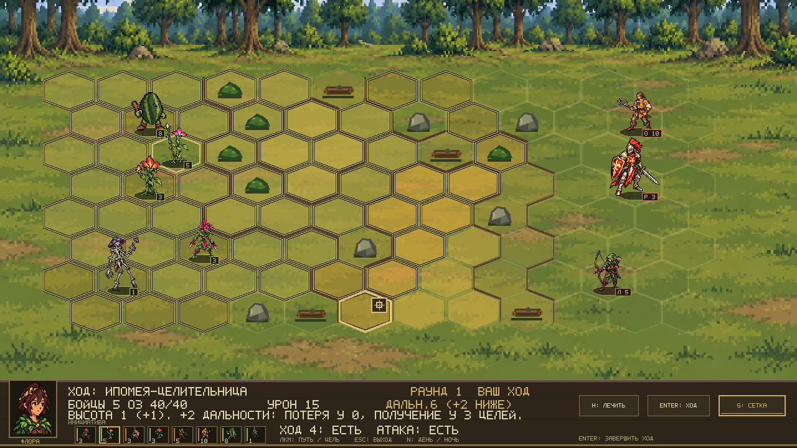
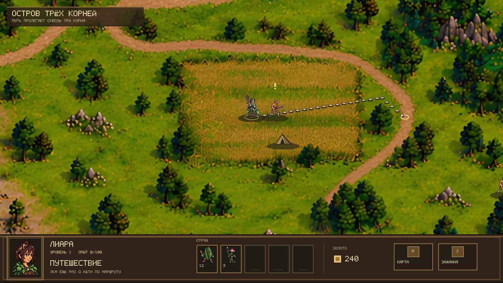
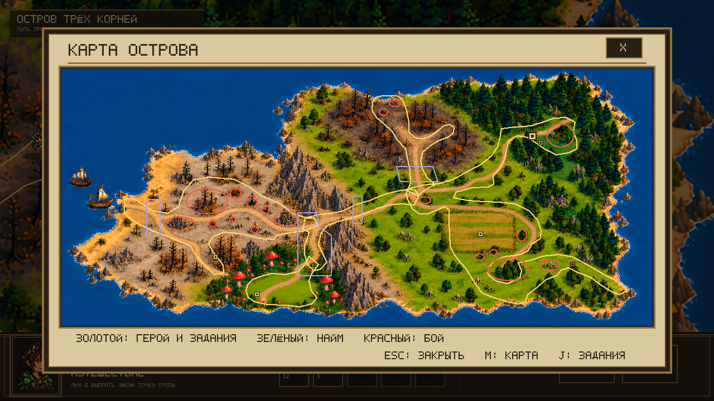
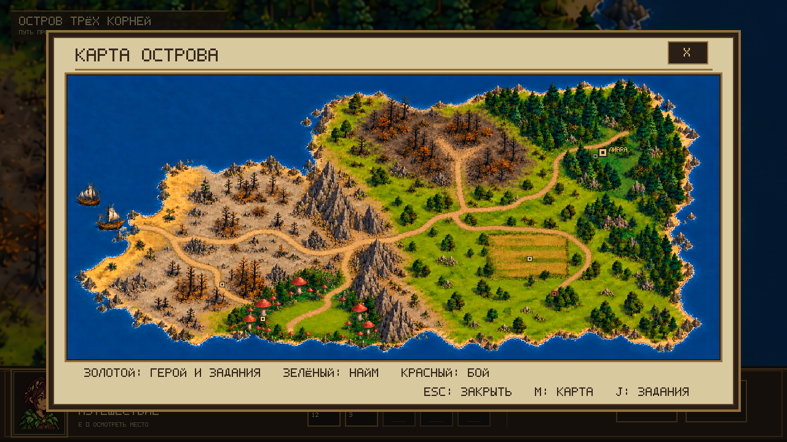
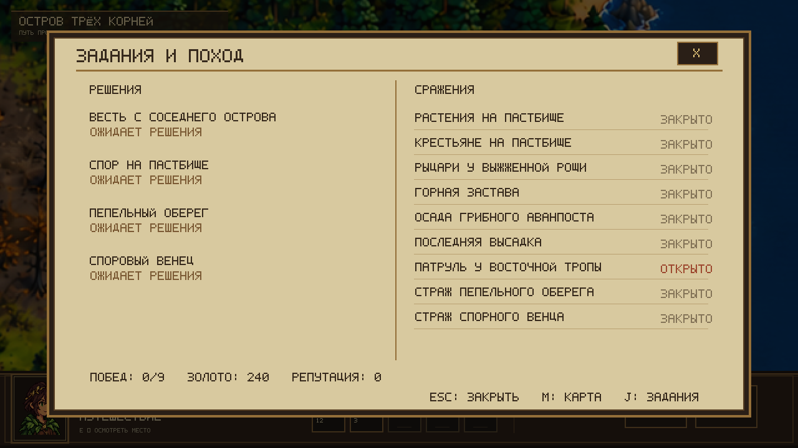

# Три корня

[](https://github.com/nyakegara/three-roots-rpg/actions/workflows/ci.yml)

**Три корня** — курсовая игра на C# и MonoGame: небольшие сюжетные кампании, исследование островов и пошаговые бои на гексах. Проект сделан без игрового движка; правила игры отделены от отрисовки, а карты и кампании описаны в JSON.

> Сейчас готовится первая кампания — защита острова народа флоры. Её расположение следует плану из Paint: западная высадка и пепельные пустоши, центральный горный хребет, южный грибной аванпост, пастбища на востоке, выжженный север и стартовый лес на северо-востоке.


> Скриншоты показывают текущие игровые прототипы. Фон острова собирается из четырёх частей одной широкой карты, а дороги и проходимость задаются отдельно в файле карты.

## Возможности

- Исследование большой прокручиваемой карты: движение к точной точке клика, плавная ходьба и обход препятствий.
- Квесты с выбором, поселения с наймом, золото и опыт; репутация меняет цену найма только в поселениях своей фракции.
- Тактические бои на гексах: высота, дальность, стек существ, лечение и противник под управлением ИИ.
- 17 типов войск трёх фракций и основа для трёх отдельных кампаний. Первая кампания — остров флоры — находится в разработке. Прогресс сохраняется, таблица рекордов хранится в JSON.
- Сменяемые PNG для карты, персонажей, юнитов, построек и поля боя.

Для пяти войск людей первой кампании готовы спрайты и атласы атак. В бою атаки проигрываются при действиях игрока и ИИ; инквизитор использует разные позы для молота и священного огня. Кабачок-проводник, крестьянин, рыцарь и инквизитор на карте исследования получили idle-анимации. Все клипы можно просмотреть в [локальной галерее анимаций](docs/art/animations/preview.html).

Idle людей обновлены до v2 по текущим боевым образам: вилы крестьянина, плюмаж и герб рыцаря, тяжёлая броня и пылающий молот инквизитора. [Исходники, импорт и проверка](docs/art/human-idle-v2.md). Старые человеческие атласы атак в галерее помечены как архивные; в бою используются отдельные утверждённые позы.

Дальнобойные и магические атаки показывают летящий снаряд и попадание: стрела лучника, лоза, пламя, споры гриба и священный огонь. Лечение показывается зелёным листом. Эти эффекты рисуются средствами C# и не меняют правила расчёта урона.

Приседающая атака ловчего сохраняет размер тела и нижнюю опору вместо растягивания до высоты стойки: [перед ударом](docs/screenshots/combat-hunter-rest-current.png) / [во время удара](docs/screenshots/combat-hunter-attack-current.png).

Характеристики, раунд и остаток действий в боевой панели увеличены для читаемости. Дальность подписана как базовая с бонусом +2 по целям ниже; при наведении прогноз урона использует тот же расчёт, что и удар, включая бонус ловчего против стрелков.



[Лечение](docs/screenshots/combat-hud-heal-current.png) · [Ночной бой](docs/screenshots/combat-hud-night-current.png) · [Священный огонь инквизитора](docs/screenshots/inquisitor-holy-fire-current.png).

Яркая золотая область показывает доступную линию атаки; приглушённые кресты отмечают перекрытый выстрел в пределах дальности. Зелёное движение остаётся доступным после атаки, если ещё не использовано. [Пример доступной цели](docs/screenshots/combat-available-shot-current.png) · [перекрытый выстрел](docs/screenshots/combat-blocked-shot-current.png) · [движение после атаки](docs/screenshots/combat-after-attack-current.png).

Юнита можно выбрать по видимой модели или подписи численности, включая верх высоких спрайтов над соседним рядом гексов. Прозрачные промежутки пропускают клик на землю. [Наведение на голову рыцаря](docs/screenshots/combat-sprite-target-current.png).

Пока отряд выполняет действие, боевые кнопки приглушены, курсор команды и интерактивная подсветка скрыты. После его завершения управление возвращается; очередь и характеристики остаются видны. [Пример текущего действия](docs/screenshots/combat-action-busy-current.png).

## Первая кампания: остров трёх корней

Проходимость описывается полигонами в `content/maps/flora-01.json`: разрешённые области, отдельные препятствия и сюжетные преграды. Герой движется по сглаженному пути к точной цели; бои используют собственную гекс-сетку. Точная позиция сохраняется автоматически, старые сохранения поддерживаются.

При выборе NPC героиня останавливается рядом с ним, а не внутри модели. E и клик используют одинаковую доступность взаимодействия; открытие диалога останавливает предыдущий маршрут. [Пример подхода к точке](docs/screenshots/npc-approach-current.png).

В боевой полосе очереди активный отряд всегда стоит первым: уже походившие и погибшие скрываются до следующего раунда. [Пример конца раунда в бою 5 на 5](docs/screenshots/combat-initiative-current.png).



Для проверки границ проходимости можно включить F3 и открыть карту клавишей M. Золотые контуры показывают разрешённые области, красные — препятствия, фиолетовые — ещё закрытые сюжетные проходы.



Крупные области, главные тропы и береговая линия повторяют план кампании из Paint. Камера следует за героиней по большой карте; путь в выжженный северный лес становится доступен после боя у пастбища. К горной засаде можно подойти независимо от освобождения севера, но для перехода на запад нужно победить засаду. Девять боёв расставлены по авторской разметке. Проходимость и квестовые точки хранятся в `content/maps/flora-01.json`.


Кнопки внизу экрана открывают общую карту острова и журнал решений и боёв:

Завершённые квестовые маркеры скрываются на основной и обзорной картах, а точки на обзоре используют собственные координаты из JSON. Неподалёку от доступного места панель подсказывает взаимодействие через `E`.





## Запуск

Для проверки ночных исправлений есть [короткий маршрут ручного теста](docs/morning-playtest-2026-10-21.md) с точным каталогом запуска и ожидаемым поведением карты, найма и боя.

Нужен .NET 10 SDK. Из корня репозитория:

```powershell
dotnet restore ThreeRoots.sln
dotnet build ThreeRoots.sln
dotnet test ThreeRoots.sln
dotnet run --project src/Game.MonoGame/Game.MonoGame.csproj
```

Для отдельного боя с ИИ:

```powershell
dotnet run --project src/Game.MonoGame/Game.MonoGame.csproj -- --combat
dotnet run --project src/Game.MonoGame/Game.MonoGame.csproj -- --combat --seed 42 --night
```

В исследовании ЛКМ выбирает маршрут, повторный клик по цели подтверждает движение; `E` осматривает точку, `M` открывает карту, `J` — журнал заданий. Панели закрываются той же клавишей, кнопкой `X` или `Esc`. В бою ЛКМ выбирает клетку и подтверждает ход, `Enter` завершает ход, `G` переключает сетку, `N` меняет освещение.

## Как устроен код

- `src/Game.Core` — правила, карта, кампания, бой, экономика и сохранения на чистом C#.
- `src/Game.MonoGame` — окно MonoGame, ввод, экраны и рисование.
- `content/campaigns`, `content/maps`, `content/units` — игровой контент в JSON.
- `content/art` — заменяемые изображения и инструкция по их размерам.
- `tests/Game.Tests` — проверки правил и загрузки контента.

Для знакомства с классами и связями между игровыми системами открой [руководство по архитектуре и ООП](docs/architecture-guide.md).

Кампания острова обсуждается и проверяется в [issue #33](https://github.com/nyakegara/three-roots-rpg/issues/33); швы карты и читаемость локаций отслеживаются в [issue #34](https://github.com/nyakegara/three-roots-rpg/issues/34). Сборка и тесты запускаются автоматически для pull request через GitHub Actions.

## Работа над курсовой

Сейчас идёт реализация кампании флоры: ветки встречи с крестьянами, открытие северной тропы, горящий лес, горная застава, грибной аванпост и финальная высадка людей. Проверяем обе ветки квеста и доступность найма после сюжетных побед. Изображения карты и интерфейса проходят отдельное визуальное ревью.

Сохранение лежит в `%LOCALAPPDATA%\ThreeRoots\saves\flora-01.json` и обновляется после подтверждённого перемещения, выбора в квесте, найма и завершения боя. При повреждённом файле игра сохраняет его копию с суффиксом `.invalid-*.bak`, прежде чем начать новую кампанию.

После победы результат один раз записывается в `%LOCALAPPDATA%\ThreeRoots\leaderboard.json`. Счёт: 1000 за победу + 100 за каждый завершённый бой + 10 за каждое выжившее существо + оставшееся золото. Таблица хранит десять лучших результатов отдельно для каждой кампании; отдельный экран просмотра ещё предстоит сделать.

Ветки GitHub используются для изолированной работы над задачами; изменения собираются в pull request, где видны коммиты, обсуждение, проверки CI и итоговый diff.
