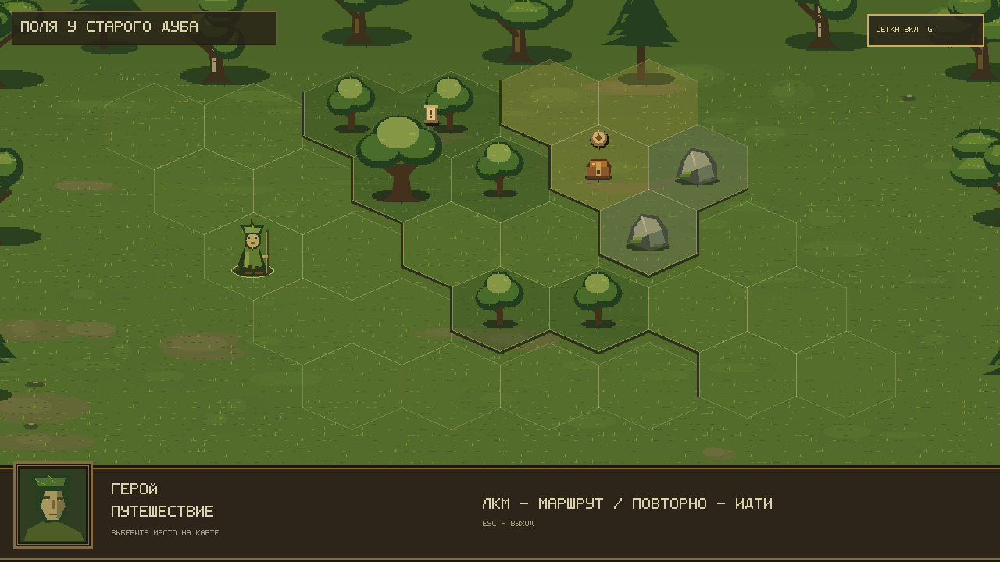
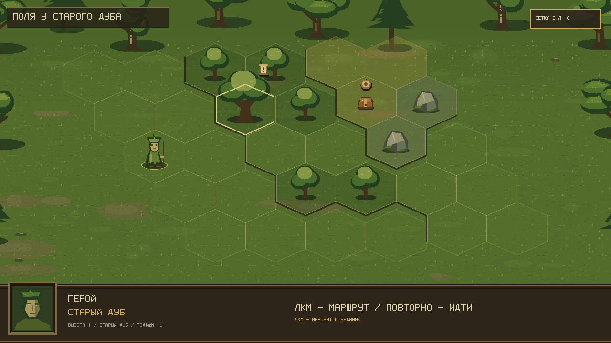

# Три корня

Курсовой проект: пошаговая RPG на C# и MonoGame, без игрового движка. Игрок исследует отдельные карты-кампании, принимает решения в заданиях и сражается на гексагональном поле.

## Требования

- .NET 10 SDK
- Windows, Linux или macOS для запуска MonoGame DesktopGL

## Сборка и запуск

Из папки репозитория:

```powershell
dotnet restore ThreeRoots.sln
dotnet build ThreeRoots.sln
dotnet run --project src/Game.MonoGame/Game.MonoGame.csproj
dotnet test ThreeRoots.sln
```

## Структура

- `src/Game.Core` — правила и модели игры; проект не зависит от графической библиотеки.
- `src/Game.MonoGame` — окно, ввод и отрисовка.
- `tests/Game.Tests` — автоматические проверки правил.
- `content` — кампании, карты и изображения.
- `docs/superpowers` — согласованный дизайн и план реализации курсовой.

## Git для этого проекта

`git status` показывает, какие файлы изменились; `git add <файл>` выбирает изменения для коммита; `git commit -m "описание"` сохраняет их в локальной истории; `git push` отправляет коммиты на GitHub. Перед каждым коммитом запускай `dotnet test ThreeRoots.sln` и проверяй `git status`.

## Модель карты

- `HexCoord` хранит axial-координаты гекса, находит шесть соседей и считает расстояние.
- `WorldTile` описывает клетку: координаты, высоту (от нуля) и проходимость. Свойства задаются при создании и затем не меняются.
- `WorldMap` хранит клетки в словаре по координатам. `Contains` проверяет наличие клетки, `GetTile` возвращает клетку или `null`, `Tiles` позволяет перечислить клетки.

Форму карты задаёт набор существующих клеток: допустимы отрицательные координаты и пустые участки. Непроходимая клетка остаётся частью карты. Повторяющиеся координаты отклоняются; изменения исходного списка клеток не меняют созданную карту.

## Исследование и экран боя

`BattleMap` хранит рельеф боевого поля. `AStarPathfinder` находит кратчайший путь по существующим проходимым гексам; занятые клетки передаются отдельно. Маршрут включает старт и цель, а его стоимость равна количеству шагов. Если пути нет, `IsReachable` равен `false`, список клеток пуст.

В A* приоритет клетки — сумма уже пройденного пути и оценки расстояния до цели. Препятствия могут увеличить реальный путь, но гекс-расстояние никогда его не завышает. При одинаковых оценках используется стабильный порядок направлений.

Обычный запуск показывает загружаемую из `content/maps/tutorial.json` карту кампании: лесную поляну, уступы, героя, квест и тайник. Гекс-сетка включена сразу. Поле занимает основную часть окна; снизу находится компактная фэнтезийная панель, отдельной панели маршрута нет:



При наведении на квест нижняя панель показывает его имя и действие:



- Наведение показывает имя и действие для квеста или тайника в нижней панели, а также высоту и тип местности.
- Первый клик ЛКМ по цели показывает путь; повторный клик по той же цели перемещает героя. ПКМ не перемещает.
- `G` или кнопка «СЕТКА» включают и выключают гекс-сетку; `E` осматривает точку под героем; `Esc` закрывает игру.

Боевой предпросмотр остаётся отдельным экраном для проверки гекс-поля и высоты. Атаки, инициатива и ИИ будут подключены отдельным этапом.

Собственные рисунки можно добавлять по инструкции `content/art/README.md`, сохраняя имена файлов. Для реального PNG-кадра из приложения можно передать абсолютный путь:

```powershell
dotnet run --project src/Game.MonoGame/Game.MonoGame.csproj -- --screenshot C:\Temp\three-roots-preview.png
dotnet run --project src/Game.MonoGame/Game.MonoGame.csproj -- --screenshot-quest-hover C:\Temp\three-roots-quest-hover.png
```

Обычный запуск и `--screenshot` показывают карту исследования. `--screenshot-quest-hover` показывает наведённый квест и его действие в HUD. `--screenshot-grid` и `--screenshot-grid-descent` сохраняют боевой предпросмотр с подъёмом или спуском. Любой режим скриншота сохраняет кадр и закрывается; обычный запуск остаётся интерактивным.
