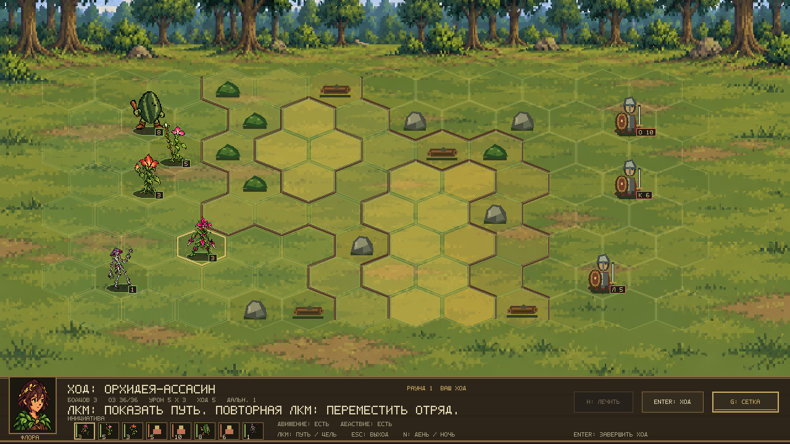
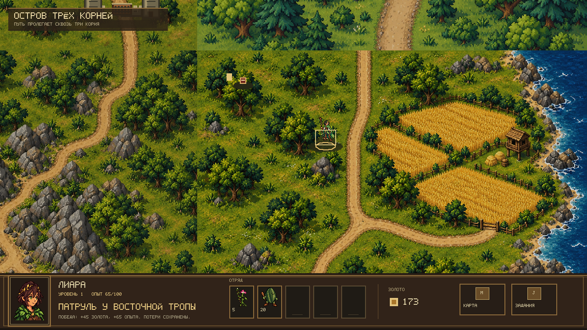
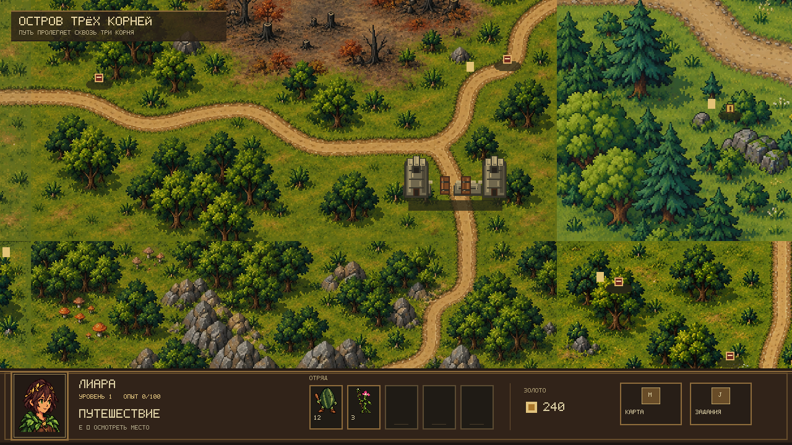

# Три корня

[](https://github.com/nyakegara/three-roots-rpg/actions/workflows/ci.yml)

**Три корня** — курсовая игра на C# и MonoGame: небольшие сюжетные кампании, исследование островов и пошаговые бои на гексах. Проект сделан без игрового движка; правила игры отделены от отрисовки, а карты и кампании описаны в JSON.

> Сейчас готовится первая кампания — защита острова народа флоры. Карта из шести тайлов и интерфейс остаются рабочими версиями; перед сдачей курсовой их можно заменить собственными рисунками.



> Скриншоты показывают текущие игровые прототипы. Шесть частей карты уже загружаются отдельно, однако переходы между ними пока заметны и будут доработаны.

## Возможности

- Исследование большой прокручиваемой карты мышью и маршрут по разрешённым клеткам.
- Квесты с выбором, поселения с наймом, золото и опыт; репутация меняет цену найма только в поселениях своей фракции.
- Тактические бои на гексах: высота, дальность, стек существ, лечение и противник под управлением ИИ.
- 17 типов войск трёх фракций и основа для трёх отдельных кампаний. Первая кампания — остров флоры — находится в разработке. Прогресс сохраняется, таблица рекордов хранится в JSON.
- Сменяемые PNG для карты, персонажей, юнитов, построек и поля боя.

Текущий вариант острова собран из шести квадратных изображений. Это макет расположения локаций и дорог, а не финальная графика: границы между некоторыми квадратами ещё заметны.



Ворота открываются после победы в бою у пастбищ в любой из веток:

| Проход закрыт | Проход открыт |
| --- | --- |
|  |  |


## Запуск

Нужен .NET 10 SDK. Из корня репозитория:

```powershell
dotnet restore ThreeRoots.sln
dotnet build ThreeRoots.sln
dotnet test ThreeRoots.sln
dotnet run --project src/Game.MonoGame/Game.MonoGame.csproj
```

Для отдельного боя с ИИ:

```powershell
dotnet run --project src/Game.MonoGame/Game.MonoGame.csproj -- --combat
dotnet run --project src/Game.MonoGame/Game.MonoGame.csproj -- --combat --seed 42 --night
```

В исследовании ЛКМ выбирает маршрут, повторный клик по цели подтверждает движение; `E` осматривает точку, `M` открывает карту, `J` — задания. В бою ЛКМ выбирает клетку и подтверждает ход, `Enter` завершает ход, `G` переключает сетку, `N` меняет освещение.

## Как устроен код

- `src/Game.Core` — правила, карта, кампания, бой, экономика и сохранения на чистом C#.
- `src/Game.MonoGame` — окно MonoGame, ввод, экраны и рисование.
- `content/campaigns`, `content/maps`, `content/units` — игровой контент в JSON.
- `content/art` — заменяемые изображения и инструкция по их размерам.
- `tests/Game.Tests` — проверки правил и загрузки контента.

Для знакомства с классами и связями между игровыми системами открой [руководство по архитектуре и ООП](docs/architecture-guide.md).

Кампания острова обсуждается и проверяется в [issue #33](https://github.com/nyakegara/three-roots-rpg/issues/33); швы карты и читаемость локаций отслеживаются в [issue #34](https://github.com/nyakegara/three-roots-rpg/issues/34). Сборка и тесты запускаются автоматически для pull request через GitHub Actions.

## Работа над курсовой

Сейчас идёт реализация кампании флоры: ветки встречи с крестьянами, ключ северных ворот, горящий лес, горная застава, грибной аванпост и финальная высадка людей. Проверяем обе ветки квеста и доступность найма после сюжетных побед. Изображения карты и интерфейса будут проходить отдельное визуальное ревью.

Сохранение лежит в `%LOCALAPPDATA%\ThreeRoots\saves\flora-01.json` и обновляется после подтверждённого перемещения, выбора в квесте, найма и завершения боя. При повреждённом файле игра сохраняет его копию с суффиксом `.invalid-*.bak`, прежде чем начать новую кампанию.

Ветки GitHub используются для изолированной работы над задачами; изменения собираются в pull request, где видны коммиты, обсуждение, проверки CI и итоговый diff.
