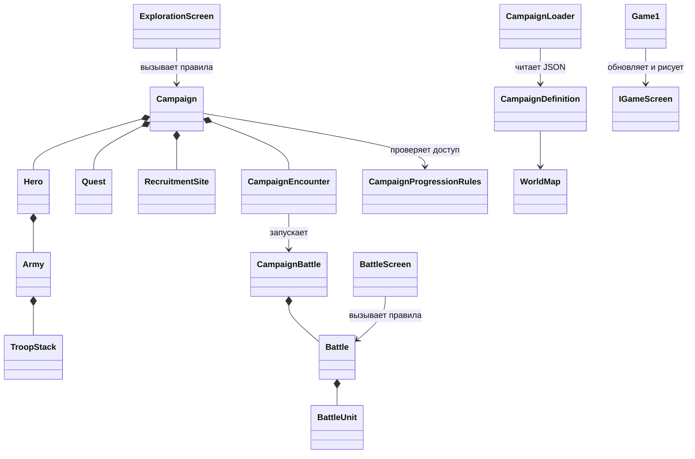

# Как устроена «Три корня»

Эта заметка помогает читать проект, менять его и объяснять на защите курсовой. Правила игры написаны на C#; MonoGame отвечает только за окно, ввод и рисование. JSON хранит настраиваемые кампании, карты и войска.

## Где искать код

| Папка | За что отвечает | Примеры |
| --- | --- | --- |
| `src/Game.Core` | Игровые правила, не зависящие от графики | `Campaign`, `Hero`, `Battle`, `WorldMap` |
| `src/Game.MonoGame` | Игровое окно, экраны, ввод и рисование | `Game1`, `ExplorationScreen`, `BattleScreen` |
| `content/` | Данные, которые можно менять без переписывания правил | `campaigns/flora-01.json`, `maps/flora-01.json`, `units/units.json` |
| `tests/Game.Tests` | Автоматические проверки поведения правил и загрузчиков | тесты кампании, боя, карты и сохранений |

При поиске по проекту удобнее начать с названия экрана или правила, а затем найти его тесты. Например, для цены найма это `EconomyRules` и `EconomyRulesTests`.

## Основные объекты и связи



Стрелка с закрашенным ромбом означает, что объект владеет частью модели: армия героя состоит из стеков, а бой — из боевых отрядов. Экраны знают о модели, чтобы передать ей действия игрока и показать результат; сама модель не зависит от MonoGame.

### Пример: как проходит бой кампании

1. `ExplorationScreen` замечает, что герой пришёл в точку столкновения, и просит `Campaign` начать встречу.
2. `Campaign` проверяет условия прогресса, берёт состав героя и данные встречи, создаёт поле и `Battle`.
3. `BattleScreen` передаёт выбранные действия объекту `Battle`; бой проверяет движение, дальность и урон.
4. После окончания `Campaign` применяет награду, сохраняет выжившие стеки и отмечает победу или поражение.

Экран не должен сам выдумывать правила урона или разблокировки. Это держит поведение проверяемым обычными unit-тестами.

### Как противник обходит стену

`BattleAi` выбирает действие, а `Battle` проверяет и выполняет его. Сначала ИИ пробует доступную атаку. Если нужно двигаться, он ищет через `AStarPathfinder` кратчайший проходимый маршрут к свободной клетке рядом с врагом. Берётся только начало пути в пределах запаса движения. Все живые отряды считаются занятыми клетками; переходить через них нельзя.

Это важно на обходах: первый шаг иногда оставляет ту же дистанцию до врага или увеличивает её. Выбор только по прямой дистанции заставлял отряд бесконечно стоять у стены. На следующем ходу путь пересчитывается по текущей обстановке. Если подойти вплотную вообще нельзя, стрелок сохраняет прежний вариант сближения: он ещё может получить выстрел через низкое непроходимое препятствие.

## Как добавить или изменить войско

1. Добавь определение с уникальным `id` в `content/units/units.json`: фракцию, здоровье, урон, скорость, движение, дальность, стоимость и способность.
2. Для доступности в кампании добавь `unitId` в предложение найма или состав встречи в соответствующем файле из `content/campaigns/`.
3. Запусти проверки: `dotnet test ThreeRoots.sln`.
4. Если у войска новая способность, найди обработку способности в `src/Game.Core/Combat` и добавь тест сначала для ожидаемого поведения.
5. Для временной графики `artKey` связывает определение с каталогом ресурсов. Изображения лежат отдельно в `content/art`, так что баланс и картинки можно менять независимо.

В общем каталоге сейчас 17 типов войск трёх фракций. Первая игровая кампания использует только нужные ей составы, а остальные подготовлены для последующих кампаний.

## Как изменить карту или сюжет

Кампания и карта — отдельные файлы: `content/campaigns/flora-01.json` ссылается на `content/maps/flora-01.json`. В кампании находятся квесты, встречи, награды, наём и требования прогресса. В карте находятся координаты, рельеф, дороги и точки интереса.

Перед изменением JSON проверь, что все ссылки указывают на существующие ID: загрузчики `CampaignLoader` и `MapLoader` выводят понятные диагностики. Свободное исследование острова использует разрешённые полигоны, препятствия и сюжетные преграды из `navigation`, независимо от нарисованного фона. Бой использует собственную гекс-сетку. Подробности — в [заметке о свободном исследовании](free-exploration.md).

## Как устроена работа через GitHub

Для каждой законченной задачи используем небольшой цикл:

1. Issue фиксирует цель и критерии приёмки. Ветку можно назвать по номеру, например `fix/34-map-seams`.
2. Ветка содержит изменения задачи; перед отправкой запускаются `dotnet build ThreeRoots.sln -c Release` и `dotnet test ThreeRoots.sln`.
3. Pull request показывает сравнение с базовой веткой, коммиты и CI. Его описание должно перечислять результат, проверки и оставшиеся известные ограничения.
4. Ревьюер смотрит diff и скриншоты, оставляет комментарии или просит изменения. После исправлений коммиты отправляются в ту же ветку; CI запускается снова.
5. PR с графикой остаётся черновиком, пока снимки не проверены визуально. После одобрения его можно слить в основную ветку.

Для этой кампании работа собрана в [PR #35](https://github.com/nyakegara/three-roots-rpg/pull/35), который пока зависит от [PR #21](https://github.com/nyakegara/three-roots-rpg/pull/21). Швы и маркеры карты описаны в [issue #34](https://github.com/nyakegara/three-roots-rpg/issues/34), ворота — в [issue #36](https://github.com/nyakegara/three-roots-rpg/issues/36). GitHub Actions автоматически собирает решение и запускает тесты для PR.

## Команды для проверки

Из корня репозитория в PowerShell:

```powershell
dotnet restore ThreeRoots.sln
dotnet build ThreeRoots.sln -c Release
dotnet test ThreeRoots.sln -c Release
```

Если тест падает, сначала прочитай имя теста и ожидаемый результат: это пример конкретного требования к поведению. Не исправляй только тест, пока не выяснишь, ошибка в правиле, данных или в самом ожидании.
