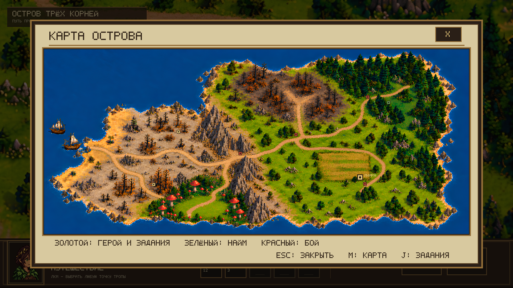
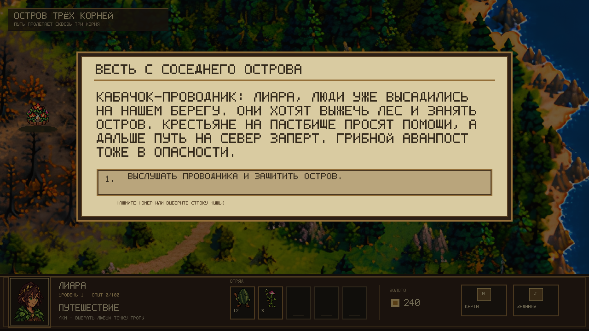

# Утренний тест: 21 октября

Проверяй версию из рабочего дерева `flora-recruitment-ui`: изменения отправлены в PR #35. Каталог `Desktop/kursach` не переключался на эту ветку.

## Запуск

Закрой прежнее окно игры. В PowerShell выполни отдельными строками:

```powershell
Set-Location C:\Users\Vasya\.codex\worktrees\flora-recruitment-ui\kursach
git log -3 --oneline
dotnet run --project src/Game.MonoGame/Game.MonoGame.csproj
```

По твоему выбору старое прохождение перенесено в резервную копию `%LOCALAPPDATA%\ThreeRoots\saves\flora-01.json.before-new-playtest-20261021-132331.bak`. Следующий запуск начнёт новую кампанию: диалог кабачка появится автоматически. После этого игра продолжает сохранение из `flora-01.json`. Если кампания уже закончена, экран результата также предлагает R для новой кампании.

## Исследование: 5–10 минут

1. Первый клик по земле показывает маршрут, второй по тому же назначению запускает ходьбу. Героиня должна останавливаться в месте клика, без привязки к квадратам. Новый клик во время ходьбы останавливает старый маршрут и показывает новый.
   Камера следует за героиней; у края острова ограничивается границами карты. Наведение мыши на край окна её больше не сдвигает.
2. Кликни за деревом или камнями внутри разрешённой области: путь должен обойти препятствие. Клик по самому препятствию не должен незаметно заменяться соседней точкой.
3. До победы у пастбища попробуй пройти в северный выжженный лес. Проход должен оставаться закрытым. F3 показывает диагностические границы, M — общий обзор; после проверки выключи F3.
4. Выбери NPC или знак `!` над ним: после подхода основания моделей должны быть раздельными. Повторный клик подтверждает подход. E открывает ближайшее доступное место и останавливает старый маршрут. Через закрытую преграду взаимодействовать нельзя.
5. В найме удерживай открывающий клик: покупки быть не должно. Отпусти кнопку и нажми «Нанять» ещё раз — золото и запас должны измениться один раз.
6. Закрой игру во время путешествия и запусти заново. Положение сохраняется во время движения примерно раз в две секунды, поэтому допустим небольшой откат вдоль пути. После прибытия и взаимодействий прогресс сохраняется сразу.

M и J открывают карту и журнал. Пока панель открыта, движение приостановлено. При закрытии клики панели не должны становиться командой движения.

## Бой: 5–10 минут

Отдельная песочница не меняет армию кампании:

```powershell
dotnet run --project src/Game.MonoGame/Game.MonoGame.csproj -- --combat
```

1. Сетка включена по умолчанию; G её переключает. Зелёный показывает доступное движение, золотой — область атаки, красный — доступные вражеские цели. Приглушённый крест внутри дальности означает перекрытую линию выстрела.
2. Наведи на верх модели рыцаря и на его численность: должен выбираться рыцарь, а не гекс за головой. Прозрачное место между частями спрайта пропускает указатель на землю.
3. У стрелка сравни значок курсора, текст прогноза и фактический выстрел. Проверь цели ниже и выше: бонус +2 даётся по целям ниже стрелка, а не просто за нахождение на любой возвышенности.
4. После атаки зелёные клетки остаются, если движение ещё не использовано. Два клика перемещают отряд; Enter завершает его ход. Действие и перемещение расходуются отдельно.
5. Посмотри атаку кабачка и флоры: размер тела не должен резко уменьшаться. В ближнем бою нет летящего оружия. Стрела лучника начинает лететь при отпускании тетивы.
6. Передавай ходы: активный отряд всегда должен стоять первым в нижней очереди. Уже походившие возвращаются в полосу с началом следующего раунда.
7. На ходу ипомеи H включает лечение: выбери раненого союзника. Лечение восстанавливает 10 суммарных HP до начального максимума стека; самого себя, врага и полностью погибший стек лечить нельзя.
8. N переключает день и ночь. Сравни читаемость сетки, стрелков, количества существ и подсказок.

## Сюжетное прохождение

Отдельно проверь обе ветки крестьян. При помощи крестьянам растения ждут южнее пастбища: выбор не должен сразу запускать бой. При отказе бой с крестьянами остаётся у места разговора. Ключ/северная тропа открываются после соответствующей победы, а не сразу после выбора. Помощь открывает найм крестьян без изменения репутации; отказ с победой даёт +1 репутации флоры.

К горной засаде можно подойти сразу, без освобождения северного леса. Саму засаду обойти нельзя: победа открывает проход на запад и к грибному аванпосту. Северная победа открывает T2, защита грибного аванпоста — T3 и доступ к финалу. Побочные патруль, небольшой отряд обезумевших растений и два артефакта необязательны. В засаде — много лучников, два рыцаря и два орденских ловчих; в финале впервые появляется инквизитор вместе с четырьмя остальными типами людей. После боя погибшие не возвращаются, выжившие полностью лечатся. Уничтожение всей армии завершает кампанию поражением.

Расстановка девяти боёв перенесена с твоего скриншота с учётом рамки окна карты. Южные растения сдвинуты на 12 пикселей исходной карты выше метки, чтобы не стоять внутри дерева. Скрытые сюжетные бои появляются по мере доступа.





## Что прислать при ошибке

Достаточно скриншота и четырёх деталей: какой отряд ходил, куда навёл/кликнул, что ожидал и что произошло. Для выстрела полезны высоты обеих клеток; для ходьбы — точка старта и назначения. Для ошибки после загрузки сохрани копию сейва.

Графика ещё требует твоей оценки: мягкость исходного фона, переходы атакующих поз людей и походка героини на 0,5×. Текущие люди используют согласованные отдельные позы; старые многокадровые атласы в галерее помечены архивными. Автотесты и воспроизводимые кадры не заменяют ручное прохождение.

[Ночная сводка и скриншоты](night-review-2026-10-21.md).
